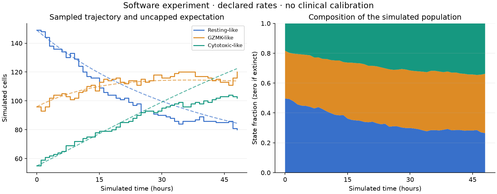
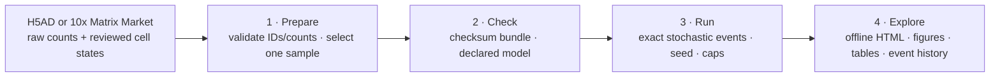
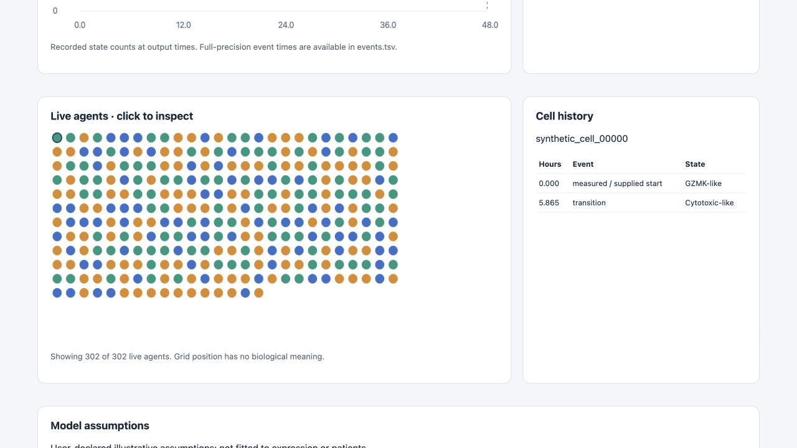

# VirtualTissue-scRNAseq

**Prepare your single-cell data, declare a cell-state model, run reproducible simulations, and inspect every event.**

This development release gives a research group a complete, local workflow for
testing simulation software with its own annotated scRNA-seq data. It includes
an offline synthetic example, a checksum-verified public PBMC example, command-line
tools, three notebooks, and an interactive HTML explorer. No API key, GPU, R
installation or paid service is needed for this workflow.

**Current scope:** non-spatial, continuous-time state transitions, division,
death and influx with **user-declared rates**. Expression and annotations define
the starting population. The software does not infer kinetic rates from a
snapshot, reconstruct tissue geometry, predict a drug response or validate a
clinical hypothesis. The original SPECIAL research audit remains separate and
its feasibility gate remains unresolved.



*Generated synthetic cells, illustrative rates, seed 21. Solid lines show one
stochastic trajectory at output times; dashed lines show the uncapped model's
mathematical expectation. These are software outputs, not patient predictions.*

## Choose your starting point

| Goal | Start here |
|---|---|
| Test installation and simulation without downloading data | [Local quick start](#local-quick-start) |
| Run a real public scRNA-seq matrix | [PBMC3k example](#public-example-pbmc3k) |
| Use your own annotated data | [Own-data guide](docs/02_your_own_data.md) |
| Use notebooks or Google Colab | [Notebook guide](notebooks/README.md) |
| Edit model assumptions | [Model guide](docs/03_model_and_assumptions.md) |
| Inspect saved runs or compare a control | [Results guide](docs/04_results.md) |
| Report a reproducible bug | [Group testing guide](docs/06_group_testing.md) |
| Continue the SPECIAL/Lin clinical study | [Separate research workflow](docs/research-audit.md) |

## The four parts



A prepared ZIP contains initial cell IDs, states, a model, provenance and
checksums. It contains **no expression matrix**. Run the same bundle repeatedly
with different seeds or explicitly changed assumptions. Checksums detect changes;
they are not signatures establishing who supplied the data.

## Local quick start

Use Python **3.12 or 3.13**. A clean installation was tested on Python 3.12/macOS;
Linux/Windows and Python 3.13 are configured in CI, with results pending the
first GitHub run.

```bash
git clone https://github.com/hylixinsights/VirtualTissue-scRNAseq.git
cd VirtualTissue-scRNAseq
python3.12 -m venv .venv
source .venv/bin/activate
python -m pip install -e ".[test,notebooks]"

# Generate counts, prepare a bundle, run a model and its no-events control.
vtsc demo outputs/my_first_test --cells 300 --hours 48 --seed 21
vtsc explore outputs/my_first_test/baseline --open
python -m pytest -q
```

On Windows PowerShell, create the environment with `py -3.12 -m venv .venv`
and activate it with `.venv\Scripts\Activate.ps1`. If activation is restricted,
use `.venv\Scripts\python.exe` and `.venv\Scripts\vtsc.exe` directly.

The demonstrated 300-cell baseline finishes with 302 cells and 394 events;
the control has 300 cells and zero events. See the saved [test summaries](reports/software/).
A control that changes population or state is a software failure. Use a new
output name for each test; existing runs are never silently overwritten.
48 **simulated** hours do not mean 48 hours of waiting.

Core numerical dependencies are pinned in `pyproject.toml`; notebook extras
have compatible ranges. The full tested environment is recorded in
`reports/software/environment-tested.txt`. The larger `requirements.lock.txt`
and R locks belong to the historical research audit.

## Public example: PBMC3k

The real-data example is **10x Genomics PBMC3k**, from one healthy donor,
licensed **CC BY 4.0** on the [original dataset page](https://www.10xgenomics.com/datasets/3-k-pbm-cs-from-a-healthy-donor-1-standard-1-1-0).
The downloader retrieves the original ~7.3 MiB archive and verifies its pinned
SHA-256. Expression data are downloaded locally, not bundled in this repository.

```bash
vtsc download-example example_data/pbmc3k
vtsc validate example_data/pbmc3k/matrix
vtsc prepare example_data/pbmc3k/matrix outputs/pbmc_input.zip \
  --recipe pbmc-cd8-demo \
  --source-license "CC-BY-4.0; 10x Genomics PBMC3k, 2016"
vtsc check outputs/pbmc_input.zip --hours 48
vtsc run outputs/pbmc_input.zip outputs/pbmc_baseline --hours 48 --seed 21
vtsc run outputs/pbmc_input.zip outputs/pbmc_control --scenario no-events --hours 48 --seed 21
vtsc compare outputs/pbmc_baseline outputs/pbmc_control outputs/pbmc_comparison
vtsc explore outputs/pbmc_baseline --open
```

The fixed demonstration recipe selects cells with detected CD3D/CD3E and
CD8A/CD8B and assigns three illustrative expression labels. It selects 427 of
2,700 source cells in the tested archive. This is a simple software fixture,
**not a validated CD8 classifier or melanoma reference**. No treatment trajectory
is observed in this dataset. Formulae, tie handling, sources and the verified
PBMC1k alternative are in the [dataset guide](docs/05_example_datasets.md).

## Your own data

Supply raw counts in H5AD or 10x Matrix Market plus a reviewed `state` annotation.
Prepare one biological sample and one timepoint per bundle. A longitudinal
clinical cohort is not required to test the software.

```bash
vtsc model-template my_model.yaml
# Edit states, rates and rate_provenance in my_model.yaml.
vtsc validate my_cells.h5ad --layer counts
vtsc prepare my_cells.h5ad outputs/my_input.zip \
  --layer counts --state-column state --sample-id sample_01 --model my_model.yaml
vtsc check outputs/my_input.zip --hours 24
vtsc run outputs/my_input.zip outputs/my_run --hours 24 --seed 42
vtsc explore outputs/my_run --open
```

If raw counts are already in `X`, omit `--layer counts`. For Matrix Market,
provide `--metadata my_cells.tsv`; the join is by exact `cell_id`, never row
order. Multiple samples require explicit selection. The [own-data guide](docs/02_your_own_data.md)
covers metadata, Seurat export, reviewed states, duplicate identifiers,
sampling limits and common errors.

## Notebooks and Colab

| Part | Notebook | Inputs / outputs |
|---|---|---|
| 1 · Prepare | [Part1_Prepare_scRNAseq.ipynb](notebooks/Part1_Prepare_scRNAseq.ipynb) | Synthetic, PBMC3k or own counts → input ZIP |
| 2–3 · Check and run | [Part2-3_Run_Simulation.ipynb](notebooks/Part2-3_Run_Simulation.ipynb) | Input ZIP → baseline, control, results ZIPs |
| 4 · Explore | [Part4_Explore_Results.ipynb](notebooks/Part4_Explore_Results.ipynb) | Saved run/ZIP → explorer, plots and summary |

Start with [Part 1 in Colab](https://colab.research.google.com/github/hylixinsights/VirtualTissue-scRNAseq/blob/main/notebooks/Part1_Prepare_scRNAseq.ipynb),
then [Parts 2–3](https://colab.research.google.com/github/hylixinsights/VirtualTissue-scRNAseq/blob/main/notebooks/Part2-3_Run_Simulation.ipynb)
and [Part 4](https://colab.research.google.com/github/hylixinsights/VirtualTissue-scRNAseq/blob/main/notebooks/Part4_Explore_Results.ipynb).
These links become available after this version is pushed. Save copies to your
own Drive and follow the [path/persistence instructions](notebooks/README.md).
The notebooks also run locally in a Jupyter-compatible editor. They do not
silently mount Drive, upload your data or contact a model API.

## What a run produces

| File | Purpose |
|---|---|
| `explorer.html` | Offline timeline, live-agent grid and selected-cell history |
| `overview.png` | Counts, uncapped expectation and state fractions |
| `trajectory.tsv`, `mean_field.tsv` | Stochastic counts and mathematical expectation |
| `events.tsv` | Every applied transition, birth, death and influx event |
| `final_cells.tsv` | Surviving IDs/states, including simulated daughters/new arrivals |
| `summary.json`, `model.yaml` | Seed, requested/observed duration, caps and assumptions |
| `run.json`, `manifest.json` | Reopenable run, provenance and checksums |
| Sibling `RUN_NAME.zip` | Shareable copy of the complete run folder |

Default caps are 5,000 live cells and 50,000 events. Reaching a cap is reported
as **incomplete** with the actual observed time. The explorer displays up to
2,000 live agents at a time; tables retain all agents/events. Grid positions
are only for display and have no spatial or biological interpretation.



## Validation and limits

Tests cover analytical expectations, Monte Carlo agreement, seeded repeatability,
population accounting, extinction, negative controls, caps, metadata alignment,
malformed counts, sample selection, checksum tampering, result reopening and HTML
escaping. Both example workflows were executed locally. See [validation evidence](reports/software/validation.md).

This release has no spatial movement, contacts, ligand fields, Jev policy,
learned rates, treatment-effect inference, state calibration, parameter fitting
or clinical validation. Division is a net +1 birth with inherited state;
simulated expression is not generated. A successful test establishes software
behavior under assumptions, not biological truth.

## Repository and licences

`src/vtsc/` contains the simulator and input/output tools; `examples/` contains
model/dataset definitions; `notebooks/`, `docs/` and `tests/` support users.
`prereg/`, historical `reports/`, `tables/` and R scripts retain the separate
SPECIAL/Lin research record. The frozen clinical design is unchanged.

Original software and generated synthetic fixtures use MIT. PBMC3k uses
CC BY 4.0 with 10x attribution; SPECIAL-derived material retains CC BY-NC-SA
4.0 and other third-party assets retain their source terms. Do not apply the
code licence to every file. See [DATA_LICENSE.md](DATA_LICENSE.md) and [CITATION.cff](CITATION.cff).

For group testing, share the version, command, model, seed, summary and smallest
permitted reproducer. Your own patient data remain in the local folders you
control; `outputs/` and `example_data/` are ignored by Git.
