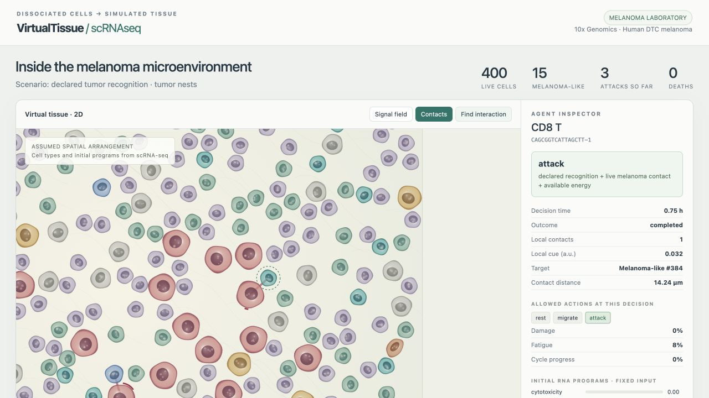

# VirtualTissue-scRNAseq

**Build an inspectable melanoma agent simulation from dissociated 10x single-cell RNA-seq.**

Load one biopsy, retain its tumor and microenvironment cells, initialize RNA programs,
and run cells that move, encounter neighbors, choose permitted actions, grow,
divide, attack or clear dead cells. Open the portable offline viewer to follow a
cell's identity, local context, allowed actions, chosen action and outcome.



This is a **v0.3 research software prototype for group testing**. RNA supplies
initial labels and program scores. Spatial arrangement and kinetic rules are
explicit hypotheses. Dissociated cells do not supply measured tissue positions.
The model does not predict a patient's response or infer antigen recognition.
It also does not yet implement the original SPECIAL plan for predicting CD8
state changes in unseen patients. See the [requirement-by-requirement alignment
audit](reports/plan-alignment-audit-2026-10-28.md); no scientific task or gate is
completed by the demonstration alone.

The example is **dissociated human melanoma**, not PBMC or Xenium. The original
v0.2 PBMC/CD8 state model addressed the wrong demonstration scope; it remains
available only as a legacy regression fixture. The main workflow below uses
the new interacting tissue engine.

## Start with real melanoma

Python **3.12 or 3.13**, macOS/Linux/Windows. The download needs `curl` (included
on current macOS, most Linux distributions and Windows 10+). After this version
has been uploaded to GitHub:

```bash
git clone https://github.com/hylixinsights/VirtualTissue-scRNAseq.git
cd VirtualTissue-scRNAseq
python -m venv .venv
# macOS/Linux
source .venv/bin/activate
# Windows PowerShell: .venv\Scripts\Activate.ps1
pip install -e ".[test]"

vtsc download-example example_data/melanoma10x
vtsc prepare-tissue example_data/melanoma10x/filtered_feature_bc_matrix.h5 outputs/melanoma-input.zip --recipe melanoma-markers --max-cells 400
vtsc run-tissue outputs/melanoma-input.zip outputs/melanoma-recognition --scenario declared-recognition --hours 24 --seed 21
vtsc run-tissue outputs/melanoma-input.zip outputs/melanoma-control --scenario recognition-off --hours 24 --seed 21
vtsc explore outputs/melanoma-recognition --open
```

The official matrix is about **57 MB**, pinned by SHA-256. Generated files stay
under ignored `example_data/` and `outputs/`. Nothing is uploaded by these commands.
For an existing checkout, start at environment creation rather than cloning.

The source is [10x Genomics: 10k Human DTC Melanoma, Chromium GEM-X Single Cell 3′](https://www.10xgenomics.com/datasets/10k-human-dtc-melanoma-GEM-X),
licensed **CC BY 4.0**. The downloaded matrix contains 10,645 cells. The example's
fixed marker recipe is provisional: review `provenance.json`, especially
`full_composition` and `sampled_composition`. The observed marker composition is
lymphocyte-rich. Uniform subsampling does **not** enrich tumor cells, invent immune
cells or preserve original neighborhood structure. Dataset details and a source
metadata discrepancy are retained in [the dataset guide](docs/05_example_datasets.md).

`declared-recognition` explicitly assumes that eligible cytotoxic cells can
recognize melanoma-labelled targets. This is a software scenario, not evidence
that those targets express cognate antigen. The default `recognition-off`
scenario disables attacks while retaining movement and growth.

## No-download test

```bash
vtsc demo outputs/synthetic-melanoma --cells 300 --hours 24 --seed 21
vtsc explore outputs/synthetic-melanoma/declared-recognition --open
```

This generates a labelled **synthetic melanoma microenvironment** for repeatable
software tests. It does not substitute for the real melanoma example. Both
recognition scenarios use the same initial cells, geometry and random seed.
Their paths subsequently diverge as actions differ.

## Use your own biopsy

Supported inputs: Cell Ranger v3+ `filtered_feature_bc_matrix.h5`, a 10x Matrix
Market directory, or AnnData `.h5ad`. Supply raw counts and reviewed `cell_type`
annotations in `obs` or a TSV joined by `cell_id`. Prepare **one sample/timepoint**.

```bash
vtsc validate my_biopsy.h5ad --layer counts
vtsc prepare-tissue my_biopsy.h5ad outputs/my-input.zip --layer counts --cell-type-column cell_type --sample-id patient01_pre --max-cells 400
vtsc tissue-template examples/my-assumptions.yaml
vtsc run-tissue outputs/my-input.zip outputs/my-run --config examples/my-assumptions.yaml --scenario recognition-off
vtsc explore outputs/my-run --open
```

Map annotations to `Melanoma`, `CD8_T`, `T_cell`, `NK`, `Myeloid`, `Fibroblast`,
`Endothelial`, `B_cell`, or `Unknown`. Unknown cells remain visible and take
space; unsupported identities are not silently converted. At least one
melanoma-labelled cell is required. Human gene symbols must be in `var_names`
or `var['gene_symbols']`. No cell type is added to compensate for missing cells.
See [the own-data guide](docs/02_your_own_data.md) for input contracts, metadata
and Seurat export guidance.

## What the agents do

| Component | Implemented behavior | Source |
|---|---|---|
| Initial identity | Reviewed labels or explicit provisional marker recipe | Input RNA / user annotation |
| Initial programs | Cytotoxicity, proliferation, interferon | Fixed marker panels, log-normalized counts |
| Geometry | Non-overlapping discs; two assumed tumor nests or mixed placement | User-selected spatial hypothesis |
| Movement | Local generic cue gradient + seeded exploration, excluded volume | Declared rule |
| Decision menu | Contact, lineage, fatigue and cycle gates | Local state at each step |
| Cytotoxicity | Contact damage only with declared recognition; fatigue and recovery | Declared rule modulated by initial cytotoxic score |
| Growth/division | RNA-modulated cycle; growth and daughter placement require space | Declared rule |
| Clearance | Myeloid contact clearance or corpse timeout | Declared rule |
| Viewer | Membranes, nuclei, contacts, cue field, playback, zoom/pan, agent history | Recorded state and events; schematic cell shapes |

The local policy chooses from the kernel's allowed actions. Every choice and its
outcome is saved. These are explicit programmed decisions, **not Jev/LLM calls**.
No paid service or external API is used. There is no anti-PD-1 drug mechanism,
learned ligand–receptor network, measured diffusion, vascular supply, calibrated
TCR specificity or validated treatment-response model in this version.

For equations, units, action priority, limitations and controls, read
[model and assumptions](docs/03_model_and_assumptions.md).

## Inspect and share a run with the group

Open `explorer.html` directly in a browser; it works offline with no CDN. Click
**Find interaction** to jump to a recorded attack and zoom onto the agent. Click
any cell to inspect its input scores and recent decisions. Drag to pan, use Fit
to reset, toggle Signal field, and scrub or play the timeline. Appearance is a
schematic rendering, not a microscopy reconstruction.

Every run saves:

- `explorer.html`: self-contained viewer;
- `run.json`: frame coordinates, lineage catalog, programs, decisions and events;
- `decisions.jsonl` and `events.jsonl`: machine-readable audit trail;
- `trajectory.tsv`, `summary.json`, `assumptions.yaml`, `provenance.json`;
- `manifest.json`: checksums, plus a sibling results ZIP.

Reopen and verify a saved archive without rerunning:

```bash
vtsc explore outputs/melanoma-recognition.zip --html outputs/reopened-melanoma.html --open
```

The original `compare` command belongs to the legacy nonspatial engine. For
new tissue runs, compare `trajectory.tsv`, `summary.json` and decisions from
matched input bundles; use several seeds and both layouts before interpreting
spatial sensitivity. [Results guide](docs/04_results.md).

## Notebook workflow

Install `pip install -e ".[notebooks]"`, then run:

1. [Part 1 — prepare melanoma](notebooks/Part1_Prepare_scRNAseq.ipynb): real example, synthetic fixture or own biopsy.
2. [Parts 2–3 — run agents and control](notebooks/Part2-3_Run_Simulation.ipynb).
3. [Part 4 — inspect saved results](notebooks/Part4_Explore_Results.ipynb).

The public melanoma is the notebook default. Local validation also executes the
synthetic path without network access. Hosted Colab has not been tested; the
repository must contain this release before its clone links work.

## Validation and bug reports

```bash
python -m pytest -q
vtsc verify-freeze
```

Tests cover raw-count formats and sample separation, checksums, repeatability,
contact and recognition gates, fatigue, no resurrection, population accounting,
non-overlap, movement bounds, division, negative controls, own-data preparation
and portable output. [Current validation](reports/software/melanoma-validation.md)
records the real-data run and browser checks. These are software checks,
not biological validation. [Group testing protocol](docs/06_group_testing.md).

## Research history and licences

Original code and generated synthetic fixtures: **MIT**. The public melanoma
example and its derivatives retain **CC BY 4.0** attribution. Own data retain
their source terms. See [DATA_LICENSE.md](DATA_LICENSE.md) and [CITATION.cff](CITATION.cff).

The separate SPECIAL/Lin prediction study remains at its feasibility gate.
Its frozen plan and CC BY-NC-SA assets have not been repurposed as this demo.
[Research audit](docs/research-audit.md) · [Status](reports/STATUS.md) ·
[A04 scope correction](prereg/amendment-A04-melanoma-prototype-2026-10-27.md).

The [VirtualTissue-Xenium](https://github.com/hylixinsights/VirtualTissue-Xenium)
project supplies the interaction/inspection reference. Its spatial input is
measured; this project's spatial layout is assumed because its input is
**dissociated scRNA-seq**.
