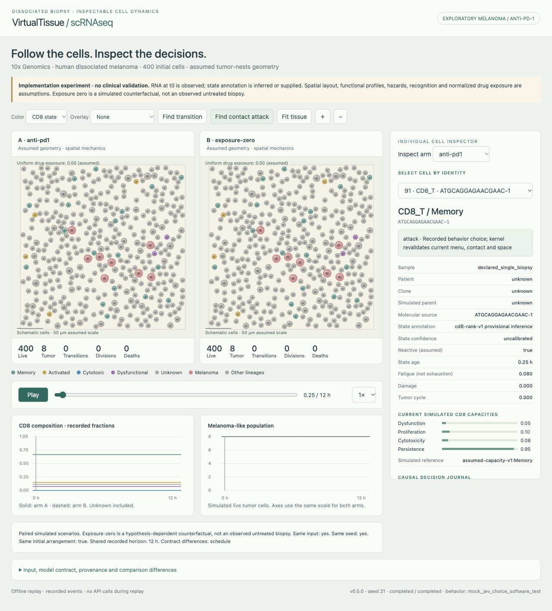

# VirtualTissue-scRNAseq

**A testable melanoma simulator with dynamic CD8 states, explicit anti-PD-1 exposure and inspectable decisions.**

Version **0.5.0** initializes one dissociated biopsy and simulates cells moving,
encountering targets, changing CD8 state, proliferating, killing, dying and being
cleared. An offline viewer compares matched arms and shows the actual causal
journal: permitted moves, hazards, probabilities, random draw, state age,
contacts, checkpoint inhibition and drug exposure.

This is an **exploratory implementation**, with assumed rates and geometry.
It is **not a clinically validated treatment-response or patient-prediction
model**. SPECIAL validation has its own unchanged task board and gates.



## Install and run an offline example

Use Python **3.12 or 3.13**. Clone [VirtualTissue-scRNAseq](https://github.com/hylixinsights/VirtualTissue-scRNAseq) and enter its directory before installation.

```bash
git clone https://github.com/hylixinsights/VirtualTissue-scRNAseq.git
cd VirtualTissue-scRNAseq
python -m venv .venv
source .venv/bin/activate
# Windows PowerShell: .venv\Scripts\Activate.ps1
python -m pip install -e ".[test,notebooks]"
vtsc demo outputs/my-first-melanoma --cells 120 --hours 24 --seed 21 --decision-mode mock-jev
vtsc explore outputs/my-first-melanoma/comparison --open
```

Choose a **new output name** for each run. The demo uses generated synthetic data and **mock Jev answers**, not a patient or live AI. Local/mock workflows are offline after installation/source download.
The viewer is self-contained; use a current Chrome/Edge/Safari/Firefox supporting
`DecompressionStream` to open `explorer.html`, including directly from disk.

## Run the public melanoma example

```bash
vtsc download-example example_data/melanoma10x
vtsc prepare-tissue example_data/melanoma10x/filtered_feature_bc_matrix.h5 outputs/melanoma-input.zip --recipe melanoma-markers --max-cells 400 --seed 21
vtsc run-melanoma outputs/melanoma-input.zip outputs/anti-pd1 --arm anti-pd1 --hours 24 --seed 21
vtsc run-melanoma outputs/melanoma-input.zip outputs/exposure-zero --arm exposure-zero --hours 24 --seed 21
vtsc compare-melanoma outputs/anti-pd1.zip outputs/exposure-zero.zip outputs/comparison
vtsc explore outputs/comparison --open
```

The pinned [10x DTC melanoma matrix](https://www.10xgenomics.com/datasets/10k-human-dtc-melanoma-GEM-X)
is approximately 57 MB, CC BY 4.0, with 10,645 cells and 38,606 features. The source
is lymphocyte rich. Proportional sampling preserves the measured composition
within integer quotas; it does not enrich tumor or manufacture missing cells.
Malignancy and the marker state recipe remain provisional. The recipe's real-data
coverage, Unknown assignments and poor four-state separability are reported in
[the validation report](reports/product-v04/VALIDATION.md). No state was added to
force a desired demonstration. Source anatomical metadata conflict is retained.

## Jev decisions and Xenium comparison

The reference is the latest published [Xenium v0.1.3](https://github.com/hylixinsights/VirtualTissue-Xenium/releases/tag/v0.1.3).
Version 0.5 adds a bounded Jev Choice adapter, batched behavior menus, target
approach, durable request journals and zero-cost preflight. The kernel retains
state hazards, movement limits, contact damage, death and division. The viewer
separates behavior probabilities from stochastic fate probabilities.

```bash
vtsc check-melanoma outputs/melanoma-input.zip outputs/preflight
# Live calls only after the operator provides a key and explicitly authorizes a ceiling:
vtsc run-melanoma outputs/melanoma-input.zip outputs/live-jev --decision-mode jev --allow-paid --max-http-attempts 100 --hours 12
```

Use TYPESAFE_API_KEY in the environment; never commit it. `mock-jev` needs no key.
[Comparison, exact differences, paid opt-in and recovery](docs/10_xenium_parity_and_jev.md)
· [v0.5 verification](reports/xenium-parity/VALIDATION.md).
Unlike Xenium, scRNAseq starts from assumed geometry and has one generic cue,
not measured polygons and ten fields. RNA score representations also differ.
No live Jev or biological equivalence is claimed.

## Psoriasis skin data on your own computer (GSE173706)

The public psoriasis dataset (lesional, non-lesional and healthy skin; Ma et al.
2023, GEO GSE173706) is downloaded from NCBI, so run this where
`ftp.ncbi.nlm.nih.gov` is reachable. Needs Python 3.12 or 3.13, a few GB of free disk
and 16 GB of RAM for the full pipeline.

```bash
git clone https://github.com/hylixinsights/VirtualTissue-scRNAseq.git
cd VirtualTissue-scRNAseq
bash scripts/local_psoriasis.sh            # download, build, annotate, trajectory, communication
# or: bash scripts/local_psoriasis.sh download   (only the raw-count .h5ad)
```

The script creates `.venv-scrna/`, downloads into `data/raw/GSE173706/` (resumes and
retries; rerun the same command after an interruption) and writes everything else to
`data/psoriasis/`: `GSE173706_raw.h5ad`, `annotated/` (labels, report, frequency
tables), `trajectory/`, `communication/`, and `psoriasis_results_small.zip` with
only the tables and reports. On Windows use WSL or Git Bash, or run the Python
commands inside the script one by one. Details:
[docs/datasets/psoriasis_GSE173706.md](docs/datasets/psoriasis_GSE173706.md).

## Bring your own biopsy

Inputs: H5AD (`X`, `layers['counts']` or `.raw.X`), Cell Ranger v3+ H5, or 10x
MTX. Use raw counts, unique barcodes and human gene symbols. Reviewed `cell_type`
and `cd8_state` can be supplied in `obs` or a TSV joined exactly by `cell_id`.

```bash
vtsc prepare-tissue my_biopsy.h5ad outputs/my-input.zip --layer counts --metadata my_cells.tsv --sample-id patient01_pre --max-cells 400
vtsc melanoma-template outputs/my-contract.yaml
vtsc run-melanoma outputs/my-input.zip outputs/my-run --config outputs/my-contract.yaml
vtsc explore outputs/my-run --open
```

CD8 states: **Memory, Activated, Cytotoxic, Dysfunctional, Unknown**. Other
lineages have no CD8 state. If reviewed states are unavailable, explicitly choose
`--state-recipe rank-markers-v1`. `--recipe melanoma-markers` requests provisional
lineage **and** state annotation. Ensembl-only inputs require `--gene-map` or
`var.gene_symbols`. Normalized counts, duplicate IDs, invalid states and pooled
biopsies are rejected. [Complete input guide and Seurat export](docs/02_your_own_data.md).

## What changes in the engine

| Layer | Implemented behavior | Evidence |
|---|---|---|
| RNA t0 | Immutable marker counts, initial axes and source hashes | Observed counts / inferred scores |
| Identity | Lineage, sample, patient, clone, parent and molecular source stay separate | Supplied/unknown; daughter links simulated |
| CD8 state | Branching/reversible four-state graph, age and independent capacities | Assumed graph and profiles |
| Anti-PD-1 | Scheduled normalized exposure reduces a PD-1/PD-L1 inhibition term | Assumed protein activities; no clinical dose/PK |
| Fate | Competing state-transition, division and death hazards; Poisson influx | Same kernel as the nonspatial solver |
| Space | Exclusion, migration, contact damage, tumor division and clearance | Assumed geometry/mechanics |
| Inference | M0/M1/M1b/M2/M3, Dirichlet-multinomial likelihood, baseline uncertainty, regularized estimation | Synthetic recovery only |
| Policy | Optional Jev behavior choices, mock contract test or local rules; CD8 fates stay with the kernel | Live integration available; validation used mock answers only |

Dysfunction is separate from fatigue, proliferation, cytotoxicity and persistence.
Dysfunctional cells can proliferate. Transitions update capabilities used in the
next actions. Unknown cells stay Unknown. No future measured RNA is fabricated.
See [equations and ODD](docs/07_dynamic_contract.md) and [schemas](docs/08_schemas.md).

## Controls, uncertainty and recovery

Arms: `anti-pd1`, `exposure-zero`, `recognition-off`, `checkpoint-off`,
`transitions-off`, `spatial-shuffle`, `frozen`. **Exposure zero is not recognition
off.** The first is a hypothetical no-drug counterfactual; the second disables
recognition. Same seeds and contract give paired initial conditions. The drug
need not improve outcomes under every context or assumed parameter setting.

```bash
vtsc ensemble-melanoma outputs/melanoma-input.zip outputs/ensemble --seeds 21 22 23 24 25 --hours 24
vtsc explore outputs/anti-pd1.zip --html outputs/reopened.html
vtsc recover-melanoma outputs/anti-pd1.zip outputs/recovered --hours 48
```

Recovery deterministically recomputes the original history, checks the recorded
prefix and optionally extends it; it is not a hidden checkpoint service. Keep
the same runtime/environment and use full-step horizons. Ensembles save paired
variation and predeclared sensitivity to recognition, checkpoint strength and
transition timescale. Simulation variation is not a patient confidence interval.

Outputs: `run.json`, `decisions.jsonl` (hash chained), `events.jsonl`,
`trajectory.tsv`, `summary.json`, `assumptions.yaml`, `provenance.json`, offline
`explorer.html`, checksummed manifest and a sibling ZIP. The comparison viewer
synchronizes playback, offers lineage/state colors, cue/drug overlays and
keyboard-accessible cell selection. [Results guide](docs/04_results.md).

## Notebooks and verification

1. [Prepare a biopsy](notebooks/Part1_Prepare_scRNAseq.ipynb)
2. [Run dynamic states and paired controls](notebooks/Part2-3_Run_Simulation.ipynb)
3. [Inspect, verify and recover](notebooks/Part4_Explore_Results.ipynb)

```bash
python -m pytest -q
vtsc verify-freeze
python scripts/validate_notebooks.py
python scripts/validate_dynamics_v04.py
```

The [v0.4 engineering evidence](reports/product-v04/VALIDATION.md) and [v0.5 comparison evidence](reports/xenium-parity/VALIDATION.md) distinguish executed
local checks from configured CI. The [product board](reports/product-v04/task-board.json)
tracks P0–P6; [research status](reports/STATUS.md) preserves the original T/G board.
Synthetic recovery and mean-field consistency do not establish clinical validity.
No remote CI, Windows/Linux runtime or hosted Colab execution is claimed from
local macOS checks alone. [Group test checklist](docs/06_group_testing.md).

## Compatibility and licences

Dynamic inputs/runs use schema v2. Reprepare raw data to obtain CD8-state inputs;
v1 inputs are not silently assigned states. `run-tissue` retains the old v0.3
static-lineage engine for regression. Legacy PBMC commands are not the primary
melanoma workflow. The validated VirtualTissue-Xenium engine is unchanged.

Original code and generated fixtures: **MIT**. 10x example/derivatives: **CC BY 4.0**.
SPECIAL technical exports: **CC BY-NC-SA 4.0**, kept outside Git, not commercial
assets. Lin remains metadata-only pending matrix alignment. [Data terms](DATA_LICENSE.md)
· [Citation](CITATION.cff) · [Prospective A05 amendment](prereg/amendment-A05-exploratory-product-2026-10-28.md)
· [Changelog](CHANGELOG.md).
