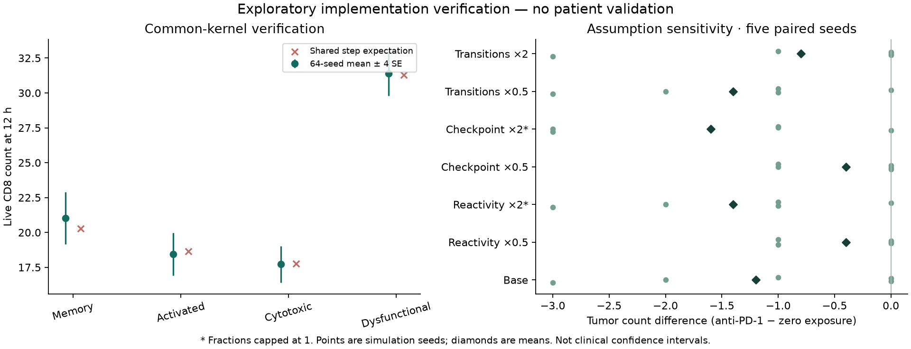

# v0.4.0 implementation verification — 2026-10-28

**Ready for group software testing. Not clinically or predictively validated.**
The delivery implements dynamic CD8 states, explicit anti-PD-1, causal journals,
own-data input and a portable viewer. Parameters and geometry remain assumptions.
P1.3 (Lin expression alignment) and P2.2 (validated CD8 reference) remain partial.
No SPECIAL response analysis, patient parameter fit, gate pass, paid provider
call, Xenium engine edit, push, PR or remote release was performed.

## Executed checks

| Check | Observed result | Evidence |
|---|---|---|
| Unit/integration regression | **51 passed**, none skipped; dependency deprecation warnings retained | tests.txt, pytest.xml |
| Three notebooks | All executed in real local Python kernels with synthetic input | notebook-validation.json, notebooks.log |
| End-to-end workflows | Synthetic 120-cell/24 h; real 400-cell/24 h; own-data counts layer, barcode join and explicit biopsy | integration.json |
| Portable recording | ZIP checksums + journal chain verified, HTML regenerated; recovery frame/decision prefixes match | integration.json; test_dynamic_workflow.py |
| Treatment controls | Zero exposure, absent checkpoint, absent recognition, no transitions, frozen, shuffled space | tests; ensemble.json |
| Actual behavioral transition | Legal Memory→Activated changes contact damage while original RNA stays identical | test_actual_state_change_increases_contact_damage_without_changing_rna |
| Mean consistency | 64 seeds; all four states within prospective 4 SE + 1 cell tolerance | dynamics-validation.json |
| Estimator | 20 fits, four synthetic replicates for each V-T/P/I/TP/TPI; M0–M3 smoke checks | synthetic-design.json; dynamics-validation.json |
| Sensitivity | **90 completed runs**; seeds 21–25; 6 controls and three parameters × two scales × two arms | ensemble.json |
| Browser | Play/pause/end, synchronized scrub, transitions/attacks, keyboard identity, t0 RNA, colors, overlay, zoom/fit; zero console errors | browser-validation.json; docs/images/ |
| Clean wheel | 86807 bytes; installed in empty venv with dependencies; isolated site-packages import; demo and reopened ZIP outside checkout | wheel-validation.json |
| Clinical freeze | All protected baseline hashes match; original T/G board and claims ledger unchanged | freeze-verification.json |

The final browser-reviewed comparison is
`outputs/v04-final/comparison-final/explorer.html`, with a sibling comparison ZIP.
The synthetic equivalent is `outputs/v04-final/synthetic/comparison-final/`.
Raw simulation outputs and intermediate reviewed viewers remain preserved.
Only the final viewer includes both fixes found in visual QA: neutral non-CD8
colors in state mode and preserving inspector disclosures during resize.
The current wheel/template include these fixes. These paths are local outputs,
not bundled patient data or links expected to exist in a fresh clone.

Direct `file:` navigation is disallowed by the automated browser host; browser QA
used a loopback HTTP server serving only generated public/synthetic outputs.
Self-contained HTML contains no CDN/fetch dependency. Direct opening in each
external browser, hosted Colab, Windows/Linux execution and remote CI were not
executed here. CI is configured, not reported as passed.

## Numerical evidence and limits

The common-kernel test starts with 20 CD8 per state. At 12 h, the mean over 64
seeds was [21.015625, 18.4375, 17.71875, 31.390625]; the fixed-step expectation was
[20.26682, 18.64975, 17.75629, 31.30654].
Maximum count discrepancy from continuous expectation fell from 0.10004 at
0.5 h steps to 0.01005 at 0.05 h steps. This verifies the implemented process
in homogeneous-context mode, with spatial constraints and extra actions disabled.
Eight spatial replicas had a different composition; the saved gap includes
heterogeneous recognition/contact and space-limited births. It is not a pure
Jensen-effect estimate and not an equivalence claim for arbitrary tissue geometry.

Synthetic recovery relative mean biases ranged from -9.7% to 6.2%.
Only selected parameters were fitted; other parameters and observation
concentration were fixed. Four replicates are insufficient to establish interval
calibration. Reported intervals are penalized local-Hessian approximations.
A deliberate division/death example has Jacobian rank 1 for 2 parameters,
demonstrating non-identifiability. No claim of general recovery/identification,
full hierarchical clinical-model completion or out-of-sample patient prediction
follows from these checks.

For the real example, paired final tumor-count differences for the five seeds
were −3, 0, −2, 0, −1 under the base assumptions (mean −1.2). Zero and negative
values are retained. These are **simulated counts out of eight initial
provisionally labelled tumor cells**, not efficacy estimates. Sensitivity and
all seeds are shown below; no attractive seed was selected. The ensemble used
the initial accepted input bundle; `ensemble-input-equivalence.json` verifies
its 400 cell records exactly match the final bundle (only provenance text changed).



## Input and annotation evidence

The full 10x biopsy contains 10645 cells. Provisional labels include 723 CD8,
219 melanoma-like and 940 Unknown. Proportional stratified sampling gives 27 CD8
and 8 melanoma-like cells in 400 agents; the other lineages remain in the input.
Full-CD8 inferred states: Memory 503, Activated 103, Cytotoxic 0, Dysfunctional 12,
Unknown 105. No Cytotoxic cells were fabricated. The reserved-marker audit has
472 assessable cells, concordance 0.852 and
kappa 0.102. High raw concordance reflects class imbalance; low kappa
and absent Cytotoxic assignments limit four-state separability. This is marker
cross-checking, not independent validated biological labels. Rules were not tuned
to this finding. Dissociation/depth correlations, coverage and program overlap
are preserved in melanoma-input-audit.json. No CNV-based malignancy confirmation,
TCR specificity or calibrated state probabilities were established.

Reviewed own-data annotations can bypass the provisional recipe. Tests cover
H5AD count layers/.raw, Cell Ranger H5, MTX, exact barcode metadata joins,
one-biopsy selection, gene mapping, invalid/normalized data and duplicate IDs.
The neutral adapter was also exercised on real immune, TME and malignant sample
exports. Acquisition/round trips and outstanding Lin limitations are in DATA_AUDIT.md.

## Runtime, resources and compatibility

Fresh-process simulation of 400 cells for 24 h took 6.51 s with
303.2 MB peak RSS on local macOS/Python 3.12.13. This measure
includes loading the prepared bundle, excludes raw H5 preparation and
HTML/ZIP serialization, and is not a hardware-independent performance promise.
The complete multi-workflow integration took 45.4 s. The shell
`time -l` wrapper could not query kern.clockrate inside the sandbox after the
workflow succeeded; the separate portable resource measurement is authoritative.
Default recording budget is 100000 cell frames; cap termination is explicit.
The 2–2000 initial-cell limit is an input bound, not a promise of full 96 h
recording for every population. Large raw matrices require additional memory.

Schema v2 rejects silent conversion of legacy v1 inputs. The old `run-tissue`
engine and tests are preserved. Recovery recomputes into a new directory and
checks source hashes plus frame/decision history. HTML embeds compressed data,
and current browsers require DecompressionStream support.

## Reproduce

```bash
python -m pytest -q
vtsc verify-freeze
python scripts/validate_notebooks.py
python scripts/validate_dynamics_v04.py
python scripts/validate_dynamic_product.py outputs/new-integration
vtsc ensemble-melanoma outputs/new-integration/real-input.zip outputs/new-ensemble --hours 24 --seeds 21 22 23 24 25
python scripts/plot_product_verification.py
```

Download the pinned 10x example first for the integration command. New output
names are required. Wheel validation is run with a separately installed wheel
interpreter: `.venv-wheel-v04/bin/python -I scripts/validate_wheel_v04.py`.
The research task board remains independent. See task-board.json and
claims-ledger.tsv for task→evidence and assertion→evidence mappings.
